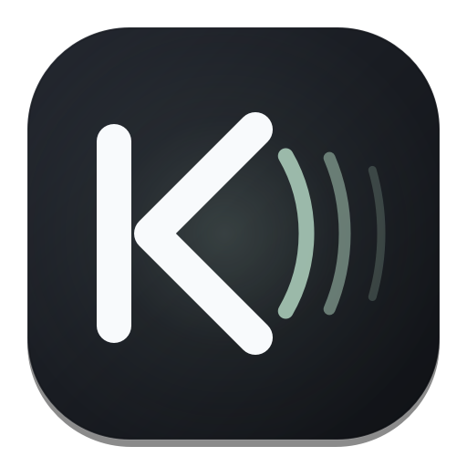

# Klang · 极简北欧音乐播放器 (Nordic Minimalist Audio Player)

<div align="center">
  
  <p><strong>以声音（Klang）与宁静（Ro）为名，重塑桌面听觉体验</strong></p>
  <p>
    <em>Nordic Minimalist Aesthetics × WinUI 3 Smooth Motions × Stateful Scipy DSP Acoustic Engine</em>
  </p>
</div>

---

## 🌟 核心特性 (Features)

### 1. 纯正北欧极简美学 (Nordic & Scandinavian Aesthetics)
* **克制色彩哲学**：告别俗艳的高饱和度渐变，采用晨雾白（Misty White）、板岩灰（Slate Gray）、灰鼠尾草绿（Danish Sage）与温暖的原木漫反射底色。
* **WinUI 3 现代视界**：极细亚克力双层半透明高光描边、四周对称 12px 圆角窗口、8 方向边缘原生拖拽拉伸。
* **字偶排版优化**：严谨的文字行高、字重阶梯与高 DPI 亚像素清晰渲染，温润舒适，久看不累。

### 2. 60 FPS 物理阻尼滚动歌词 (Spring Dynamics Lyric Engine)
* **弹簧阻尼运动学**：歌词行随音乐推进平滑居中惯性滚动，彻底告别生硬瞬移。
* **音节柔光推进**：基于线性渐变遮罩（Mask-image）的逐字柔和推进，绝无 KTV 式刺眼硬变色。
* **上下边缘羽化**：上下边界智能透明度羽化衰减，让过去与未来的歌词自然融隐于背景。
* **沉浸交互**：支持点击任意歌词精准跳转进度、歌词字号实时无级调节（`A-` / `A+`）、双语译文随心切换。

### 3. 无爆音专业声学 DSP 引擎 (Click-Free DSP Audio Engine)
* **零中断持续硬件流 (`ContinuousDspStreamDevice`)**：底层基于单通道 QAudioSink 连续拉流，实时拖拽均衡器滑块或切换音效预设时声卡硬件全程不断流、零咔哒声。
* **状态保持双二阶滤波器 (Stateful SOS Biquad Cascade)**：保持块间滤波延迟状态（$z_i$），新滤波参数先在历史样本上预热，再执行 2048 样本的余弦平滑交叉淡化（Cosine Crossfade）。
* **自动动态余量防削波 (Auto-Headroom Pre-Gain)**：针对 0 dBFS 商业母带音频，根据正向低频增益动态前置衰减，配合环状立体声混响与 $\tanh$ 柔膝限幅，彻底杜绝爆音与破音失真。
* **五大北欧调音预设**：原声自然、北欧厅堂、温暖人声、深沉低音、清澈器乐。

### 4. 完备的音乐库与扩展能力
* **全格式音频解码**：支持 MP3, FLAC, WAV, AAC, OGG, M4A 本地单曲与整个文件夹拖拽批量导入。
* **在线词图智能刮削**：自动提取歌曲 ID3 元数据，支持在线静默检索与手动精准匹配双语 LRC 歌词与高清封面。
* **独立桌面歌词 (Desktop Overlay)**：支持锁定在桌面顶部的极简悬浮歌词条，专注办公或阅读时随时感知当前旋律。
* **播放状态持久化**：本地记忆播放进度、音量、循环模式、喜欢曲目列表与最后播放歌曲。

---

## 🚀 快速启动 (Quick Start)

### 环境要求
* Windows 10 / 11
* Python 3.9+

### 1. 克隆代码
```bash
git clone https://github.com/gwj0323/klang.git
cd klang
```

### 2. 安装依赖
```bash
pip install -r requirements.txt
```

### 3. 运行播放器
```bash
python run_qt6_player.py
```

---

## 🎹 快捷键支持 (Shortcuts)

| 按键 | 功能说明 |
| :--- | :--- |
| <kbd>Space</kbd> | 播放 / 暂停 |
| <kbd>←</kbd> / <kbd>→</kbd> | 后退 5 秒 / 快进 5 秒 |
| <kbd>↑</kbd> / <kbd>↓</kbd> | 调大音量 / 调小音量 |
| <kbd>Ctrl</kbd> + 滚轮 | 无级缩放歌词字号大小 |
| 拖拽外部音频文件 | 直接拖入窗口即可自动加入音乐库播放 |

---

## 🛠️ 项目架构 (Architecture)

```text
klang/
├── qt6_player/                     # Qt 6 原生桌面应用核心
│   ├── assets/                     # 品牌徽标与图标素材 (PNG / ICO / SVG)
│   ├── components/                 # WinUI 3 极简风格组件库
│   │   ├── desktop_lyric_overlay.py# 桌面悬浮歌词
│   │   ├── equalizer_dialog.py     # 5 段均衡器与立体声厅堂混响调节弹窗
│   │   ├── fluent_widgets.py       # Fluent 现代输入框/分段器/弹窗
│   │   ├── lyrics_stage.py         # 60fps 弹簧动效滚动歌词视窗
│   │   ├── navigation_pane.py      # 左侧音乐库与播放列表侧边栏
│   │   ├── title_bar.py            # 顶部可拖拽标题栏与快捷工具组
│   │   ├── transport_bar.py        # 底部播放控制条与音量条
│   │   └── vinyl_cover_card.py     # 唱片封面旋转与卡片交互
│   ├── data/
│   │   └── tracks.py               # 歌曲模型与 LRC 解析器
│   ├── services/                   # 底层引擎与服务
│   │   ├── audio_engine.py         # 连续拉流与 Scipy SOS 防爆音 DSP 引擎
│   │   ├── metadata_service.py     # 本地音频元数据提取
│   │   ├── scraper_service.py      # 在线歌词与专辑图刮削
│   │   └── storage_service.py      # 状态记忆持久化
│   ├── theme/
│   │   └── nordic_palette.py       # 北欧设计配色规范与字体度量
│   └── main_window.py              # 主窗口集成
├── run_qt6_player.py               # 应用启动入口
├── requirements.txt                # Python 依赖库清单
├── LICENSE                         # MIT 开源许可
└── README.md                       # 说明文档
```

---

## 📄 开源许可证 (License)

本项目采用 [MIT License](LICENSE) 开源协议。
